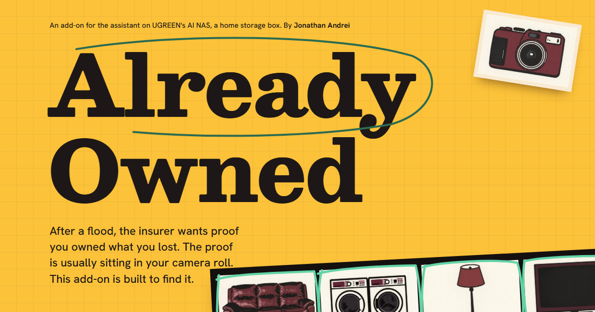
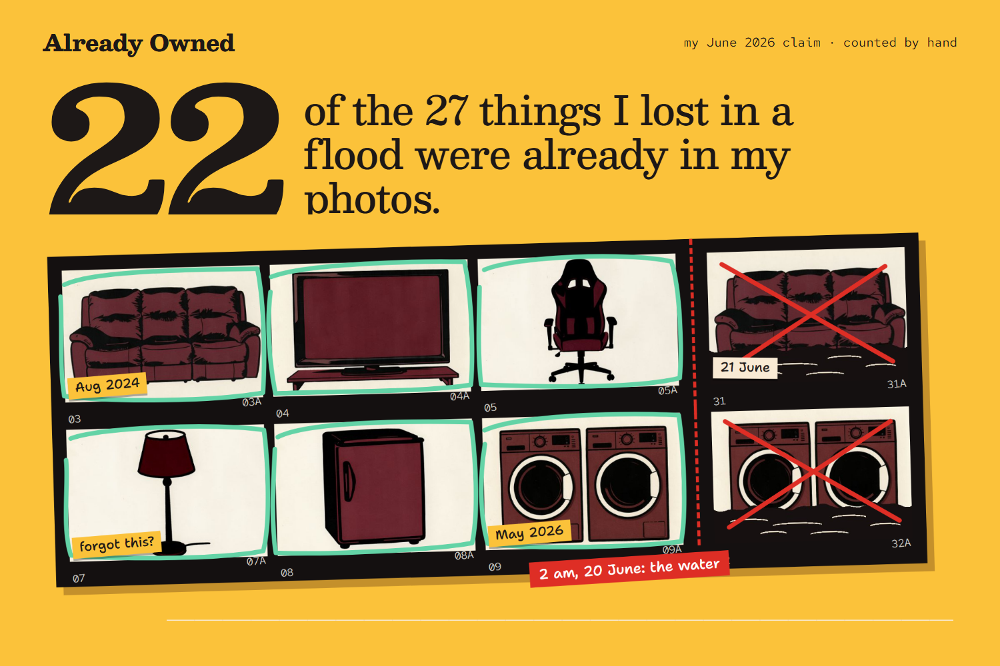
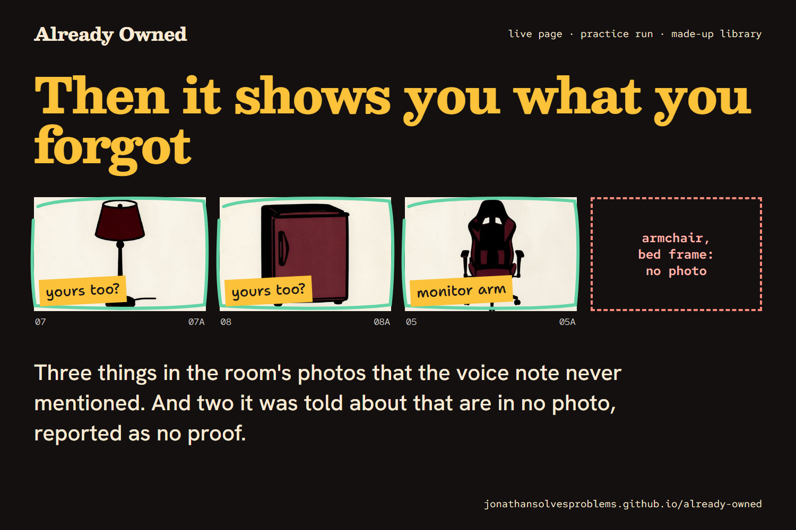

# Already Owned

**After my basement flooded, my insurer asked for every item I lost, with proof I owned it. Photos I had already taken show 22 of the 27 items. Searching the same library by file name finds 0. This Skill is built to find them and write the insurer's contents list.**

[](https://jonathansolvesproblems.github.io/already-owned/)

A Skill for UGREEN AI NAS (`home-contents-inventory`), entered in the UGREEN Hackathon 2026 on AI NAS, Open Innovation track.

| | |
| --- | --- |
| Try it without a NAS | **[Replay a full claim run](https://jonathansolvesproblems.github.io/already-owned/)** in the browser, on a phone or a desktop |
| Official checker | `static-pass`, 0 errors, 0 warnings (`uliya-skill-kit` 0.7.3, catalog 2.0.0) |
| Baseline, measured | file-name-and-date search proves **0 of 27** items of my real claim |
| Ceiling, counted by hand | **22 of 27** items appear in a photo captured before the loss, 3 more uncertain, 2 in no photo |
| Rehearsed on paper | 25-case test plan: **22 pass, 3 partial, 0 fail**; safety probes 4 of 4 |
| The Skill's own count | **not measured yet**: it needs a NAS, and it is the first thing I run if I get a day on one |
| Package | `SKILL.md` plus seven references, Markdown only, 24 steps, 24 delegations, 5 expert agents |

| | |
| --- | --- |
|  |  |

## The person and the moment

My basement flooded twice in six months. Each time the insurer wanted a list of every damaged item with proof of ownership and value. I rebuilt the June 2026 list by hand: 27 items, $10,915. Every photo on that list was taken after the water, so none of them proved I owned anything before.

The proof existed. It was in my own camera roll: the sofa in the background of a photo from December, the dumbbells under the pull-up bar, the washer in a laundry-room shot. Nothing in a phone's file names says so. `20251211_160058.jpg` does not contain the word sofa.

A former adjuster described the list insurers ask for to The New York Times in 2025: "They want a model number. They want the price. The quantity." ([source](docs/sources.md))

## What the Skill does

Three modes, chosen from what you say.

- **Update**, about weekly. "Update my home inventory." It finds belongings in the photos added since last time, pairs them with receipts, asks you to confirm once, then adds a dated page to the inventory, plus a dated album and a file tag. The inventory is a ledger: each run saves only what changed and rewrites nothing, so it grows between losses and the date an item was first written down is evidence in its own right.
- **Ask**. "What do I own in the basement?" Answered from the ledger. No search, no write.
- **Claim**, after a loss. "I had a flood on June 20 in the basement." It fixes the cut-off first. You say what was lost by typing it or by walking through the room with a voice note, which the NAS transcribes. It finds each item in a photo captured **before** the loss, adds the receipt if one exists, files the damage photos taken after, and, if you agree, the camera events around the loss. It then shows you belongings that appear in those same photos and that you did not name, because nobody remembers a whole room. On a NAS with no saved inventory it builds the list from the pre-loss photos itself. You confirm once, and it saves one claim folder you can attach as it is: the contents list, a copy of every exhibit including your voice note, and the capture time, camera and SHA-256 of each file.

What it never does:

- count a photo captured after the loss as proof of ownership (it is filed as a damage photo);
- estimate a value (prices come from a receipt or from you);
- substitute a similar item when it finds nothing (two search routes, then "no pre-loss proof");
- write without approval, or delete, move or overwrite anything;
- follow text it reads inside a photo or a receipt, or alter a receipt when asked.

## Check it yourself

```
git clone https://github.com/JonathanSolvesProblems/already-owned
cd already-owned
python tools/check_package.py
```

That script needs only Python 3.9 or later. It checks the package against the Round 1 limits (name, description length, linked references, file sizes, no scripts, required sections, single-line delegations to registered experts) and prints the step and delegation counts quoted above.

To run UGREEN's own checker, download the official Skill Developer Package from the [Hackathon Starter Kit](https://ai.ugreen.com/pages/hackathon-starter-kit), then:

```
node path/to/uliya-skill-kit/scripts/check-skill.mjs skill/home-contents-inventory
```

To run the same baseline on your own photos, give the script a CSV with a `path` and a `taken` column (one row per photo) and your own item list:

```
python tools/ablation_filename.py photos.csv --before 2026-06-20T00:00 --items results/june-2026-items.csv --out my-baseline.md
```

## What is measured and what is not

| Claim | Status | Where |
| --- | --- | --- |
| File-name-and-date search proves 0 of 27 items | Measured on my library, every hit opened and checked by eye | [results/ablation-filename-date.md](results/ablation-filename-date.md), [results/ablation-verification.md](results/ablation-verification.md) |
| 22 of 27 items appear in a pre-loss photo | Counted by hand, photo by photo | [results/pre-loss-photo-census.md](results/pre-loss-photo-census.md) |
| The workflow holds together end to end | Five paper dry runs against a mock library, a model playing the NAS: 69 defects found and fixed. Then a scored rehearsal of the package's own 25-case test plan: 22 pass, 3 partial, 0 fail, and 4 of 4 safety probes | [tests/dry-run/](tests/dry-run/) |
| The Skill finds N of 27 on a real NAS | **Not measured yet.** It needs the hardware; it is the first thing I run on it | [the test plan](skill/home-contents-inventory/references/test-plan.md) |

The replay page is a simulation with fixture data and says so on the page. The 27-item list, the 0 and the 22 are real.

## How it is built on UGREEN AI NAS

The Skill only delegates. It never calls a CLI directly, and every capability it asks for is an action in the published catalog.

| Expert | CLIs | What the Skill asks it for | Steps |
| --- | --- | --- | --- |
| `photo-agent` | `ug-photo` | search by recognized object, by text in the photo and by capture date; one description per photo by the local vision model; albums | U2, U3, U5, U10, C4a, C4b, C9 |
| `document-agent` | `ug-document` | purchase lines from receipts; claim drafting and translation | U6, C6, C8 |
| `knowledge-agent` | `ug-knowledge` | transcription of a voice walk-through; saving the dated lists | C2, U12, C9 |
| `file-agent` | `ug-filesystem`, `ug-filemgr`, `file-workflow` | inventory and receipt files, folders, tags, exhibit copies and SHA-256 | U1, U4, U9, U11, C9 |
| `security-monitor-agent` | `ug-surveillance` | camera events in the loss window, for a theft | C5 |

The package also carries a [capability map](skill/home-contents-inventory/references/capability-map.md) (every step against the catalog's actions, effects and approval levels) and a [sample claim](skill/home-contents-inventory/references/sample-claim.md) showing what the user ends up holding.

Where the model decides, in [SKILL.md](skill/home-contents-inventory/SKILL.md) and [search-routes.md](skill/home-contents-inventory/references/search-routes.md):

- **The search route per item**: file name when the inventory already names a photo, recognized object when the type is on the index's own category list, text in the photo when a brand or model is known, a window after the purchase date when a receipt is matched, and otherwise one vision pass over the room photos already returned. Two empty routes and the item is reported unproven.
- **The outcome per row**: photo and receipt, date conflict, photo only, receipt only, accessory, ambiguous. Conflicts become questions, collected and asked once.
- **What to do with each delegation state**: `completed`, `failed`, `cancelled`, `waiting_user`, `waiting_approval`. A failed write stops only the steps that depend on it.

## Limits

- Recall depends on the NAS recognition index. Two of my 27 items appear in no photo at all, and no Skill can prove those.
- Each candidate photo costs one description by the vision model, so routes are capped (12 photos per search in claim mode, 40 per category in update mode, and a question before any run over 150 photos).
- Skills cannot run on a schedule, so the weekly update is started by the user.
- A single instruction to the NAS is kept to fifteen rows, so a long list is saved in parts. Whether the platform accepts longer instructions is untested.
- Camera evidence needs a camera that covers the room.
- Nothing here has run on a real NAS yet. Round 1 gives no hardware access.
- The illustrations on the replay page are made with AI and stand in for my own photos, which stay on my drive.

## Disclosures

The package is Markdown only and has no third-party component. It was built and checked with UGREEN's `uliya-skill-kit`. At run time it uses the NAS local model only. The full statement, including the AI tools used during development, is in [disclosures.md](skill/home-contents-inventory/references/disclosures.md).

The Round 1 proposal is in [proposal/](proposal/). Code in `tools/` is under the MIT licence.
