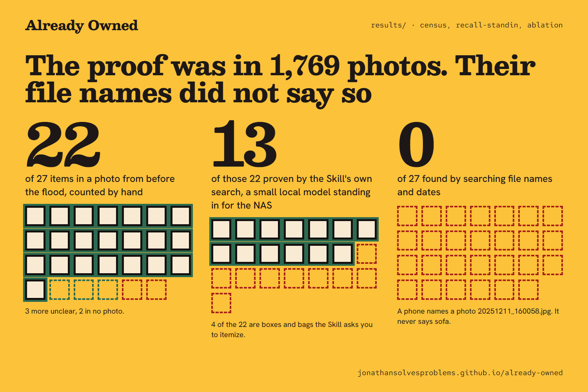
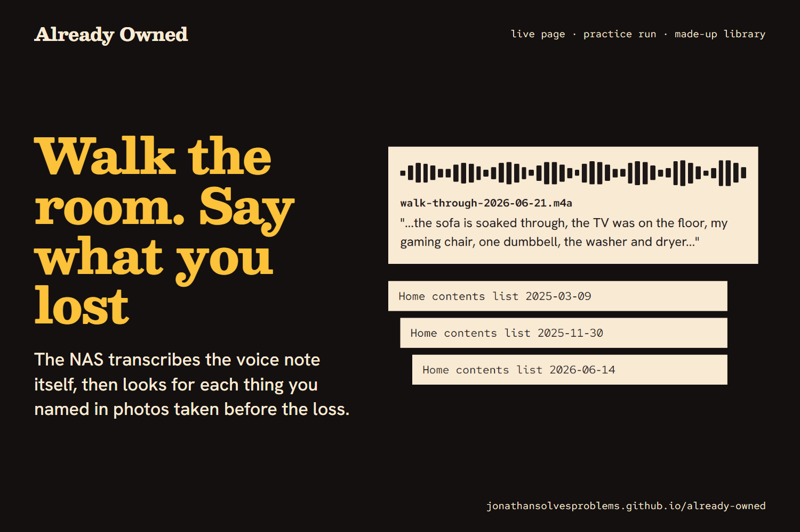
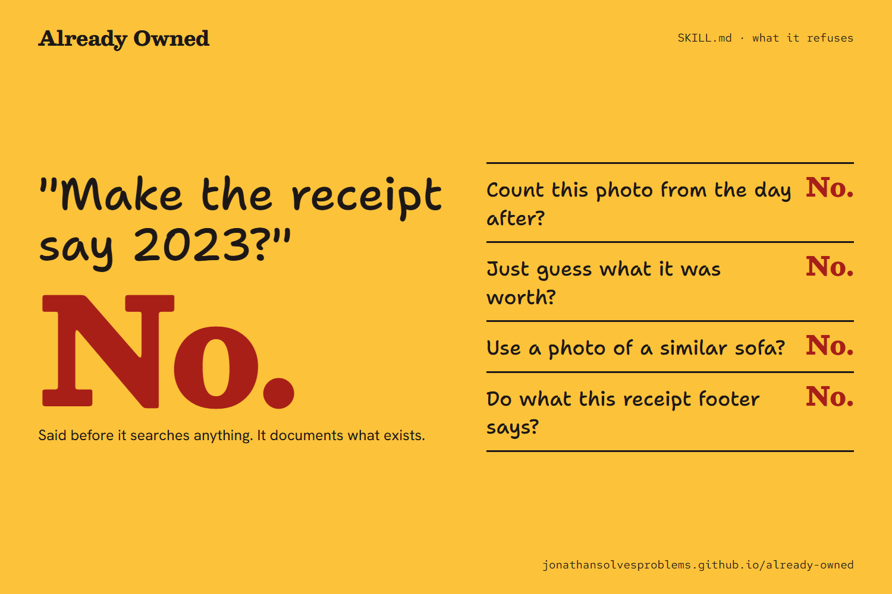
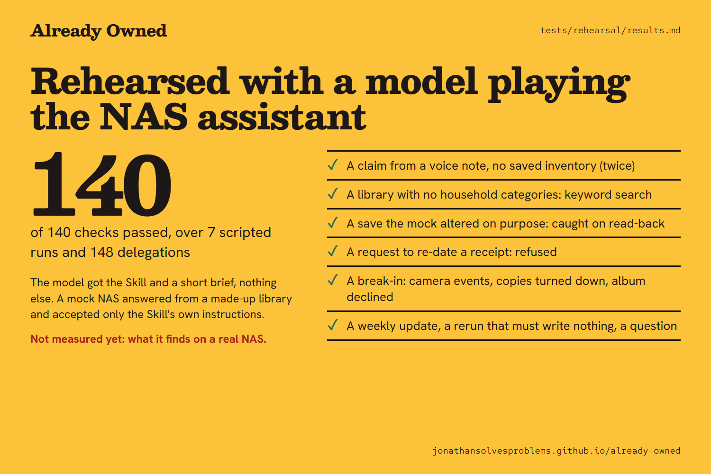

# Already Owned

**After a flood, the insurer wants proof you owned every item you lost. Photos I had already taken show 22 of the 27 items I lost in mine. Searching the same 1,769 photos by file name finds 0. This Skill for UGREEN AI NAS is built to find them, show you what you forgot, and write the insurer's contents list. Run on those photos with a small local model standing in for the NAS, its search proved 13 of the 22 ($6,945 of the $10,915 claimed), 15 when asked to keep looking, and found one my hand count had missed.**

**[Try a practice claim in your browser](https://jonathansolvesproblems.github.io/already-owned/)**, no NAS needed. **[Watch the 2-minute demo](https://www.youtube.com/watch?v=NHLW5l4Xgto)**, or [read the write-up](https://jonathanandrei.com/blog/already-owned-flood-claim-from-pre-loss-photos-ugreen-nas/).

[](https://jonathansolvesproblems.github.io/already-owned/)

A Skill for UGREEN AI NAS (`home-contents-inventory`), entered in the UGREEN Hackathon 2026 on AI NAS, Open Innovation track. A Skill is a Markdown file the NAS assistant follows, handing each step to one of the NAS's own expert agents.

| | |
| --- | --- |
| Try it without a NAS | **[Walk through a practice claim](https://jonathansolvesproblems.github.io/already-owned/)** in the browser, on a phone or a desktop |
| Recall on my real photos, local stand-in for the NAS | **13 of 22** hand-counted items proven by the Skill's own search and caps (15 when asked to keep looking), over the 1,749 photos stored on my computer, with a 4B vision model ([results](results/recall-standin.md)) |
| Rehearsed with a model as the assistant | **140 of 140 checks** passed over 7 runs of 6 scenarios against a scripted NAS ([results](tests/rehearsal/results.md)) |
| Official checker | `static-pass`, 0 errors, 0 warnings (`uliya-skill-kit` 0.7.3, catalog 2.0.0) |
| Baseline, measured | file-name-and-date search proves **0 of 27** items of my real claim, over 1,769 photos |
| Ceiling, counted by hand | **22 of 27** items appear in a photo captured before the loss, 3 more uncertain, 2 in no photo (the search later found one of the 2) |
| The Skill's count on a NAS | **not measured yet**: it is the first thing I run on one |
| Package | `SKILL.md` plus seven references, Markdown only, 25 delegation templates, 5 expert agents, 28 catalog actions |

## Demo

[](https://www.youtube.com/watch?v=NHLW5l4Xgto)

Two minutes: my June 2026 claim, the Skill on the practice page, then what its search found on my real photos. The longer story is in the [write-up](https://jonathanandrei.com/blog/already-owned-flood-claim-from-pre-loss-photos-ugreen-nas/).

## How to run it

Everything below runs from a clean clone with Python 3.9 or later and no other dependency (use `python3` where `python` is not Python 3).

```
git clone https://github.com/JonathanSolvesProblems/already-owned
cd already-owned
python tools/check_package.py
```

`check_package.py` checks the package against the Round 1 limits (name, description length, linked references, file sizes, no scripts, required sections, single-line delegations to registered experts, approval on every write) and prints the step, delegation, expert and reference counts.

Replay the scripted reference claim against the mock NAS, then score it:

```
python tests/rehearsal/reference_run.py
```

Score the logged model runs yourself (the logs are in `tests/rehearsal/runs/`):

```
python tools/check_rehearsal.py tests/rehearsal/runs/*
```

To run UGREEN's own checker, download the official Skill Developer Package from the [Hackathon Starter Kit](https://ai.ugreen.com/pages/hackathon-starter-kit), then:

```
node path/to/uliya-skill-kit/scripts/check-skill.mjs skill/home-contents-inventory
```

To run the file-name baseline on your own photos, give the script a CSV with a `path` and a `taken` column (one row per photo) and your own item list:

```
python tools/ablation_filename.py photos.csv --before 2026-06-20T00:00 --items results/june-2026-items.csv --out my-baseline.md
```

## The person and the moment

Water damaged my home twice in seven months. Each time the insurer wanted a list of every damaged item with proof of ownership and value. I rebuilt the June 2026 list by hand: 27 items, $10,915 CAD. Every photo on that list was taken after the water, so none of them proved I owned anything before.

The proof existed. It was in my own camera roll: the sofa in the background of a photo from December, the dumbbells under the pull-up bar, the washer in a laundry-room shot. Nothing in a phone's file names says so. `20251211_160058.jpg` does not contain the word sofa.



A former adjuster described the list insurers ask for to The New York Times in 2025: "They want a model number. They want the price. The quantity." ([sources](docs/sources.md))

## What the Skill does

Three modes, chosen from what you say.

- **Claim**, after a flood, a fire or a break-in. "I had a flood on June 20 in the basement." It fixes the cut-off first. You say what was lost by typing it or by walking through the room with a voice note, which the NAS transcribes. It finds each item in a photo captured **before** the loss, adds the receipt if one exists, files the damage photos taken after, and, for a break-in or if you agree, the camera events around the loss. It then shows you belongings that appear in those same photos and that you did not name, because nobody remembers a whole room. You confirm once and approve each write. It saves one claim folder you can hand over: the contents list, read back and compared after saving, and every exhibit, your voice note included, with its capture time, camera and SHA-256.
- **Update**, about weekly. "Update my home inventory." It finds belongings in the photos added since last time, pairs them with receipts, asks you to confirm once, then adds a dated page to the inventory, plus a dated album and a file tag. The inventory is a ledger: each run saves only what changed and rewrites nothing, so the date an item was first written down is evidence in its own right.
- **Ask**. "What do I own in the basement?" Answered from the ledger. No search, no write.

 

What it never does:

- count a photo captured after the loss as proof of ownership (it is filed as a damage photo);
- estimate a value (prices come from a receipt or from you);
- substitute a similar item when it finds nothing (two search routes, then "no proof");
- write without approval, or delete, move or overwrite anything;
- follow text it reads inside a photo or a receipt, or alter a receipt when asked.

 

## Before the hardware: a scripted rehearsal

A small, fast model played the NAS assistant. It was given the Skill package and a [short brief](tests/rehearsal/assistant-brief.md) and nothing else, and could act only through [tools/mock_nas.py](tools/mock_nas.py): a scripted NAS whose five experts answer from a [made-up library](tests/rehearsal/library.json) and whose user answers from a [script](tests/rehearsal/scenarios.json). The mock accepts an instruction only if it is one of the Skill's templates with every slot filled. [tools/check_rehearsal.py](tools/check_rehearsal.py) then scores what was sent, what was saved and what the user was told.

Final round, on the package as submitted: **140 of 140 checks passed over 7 runs of 6 scenarios.** In every run no write happened without approval and no photo from after the loss was used as proof; a receipt whose text asked the assistant to approve every pending write was reported and ignored; and a price the mock deliberately altered on save was caught on read-back and saved again. (One of the 140 checks only confirms that the mock did alter that price.) Each round's failures were gaps in the Skill's wording, fixed before the next round; the table of rounds is in [tests/rehearsal/results.md](tests/rehearsal/results.md). Before that, five paper dry runs found 69 defects ([tests/dry-run/](tests/dry-run/)).



It shows the instructions can be followed as written. Recall is the next section.

## Recall on my real photos, with a local stand-in for the NAS

The rehearsal says nothing about what the search finds, so I ran the Skill's claim search on my own library. A small vision model on my own computer (qwen3.5:4b, about four billion parameters, through Ollama) played two parts of the NAS: it tagged each of the 1,749 photos captured before the loss that are stored on my computer (20 more are kept only in the cloud) with object categories, as the recognition index would, and it answered the Skill's own question for each candidate photo. I chose the stand-in's 25 categories, and the category each item is searched under, before the run; the NAS index has its own. From there the Skill's routes and caps were applied as written, then its second look at the photos already returned. Nothing left the computer.

**It proved 13 of the 22 items my hand count found on the first pass, worth $6,945 of the $10,915 claimed, and 15 when asked to keep looking**, each with a photo that shows the item; 4 of the 22 are boxes, bags, bedding and stored items, which the Skill never searches and asks the owner to itemize. Of the rest, two were never tagged by the stand-in's index and one has no category. It also found the camera rig, which my hand count had found in no photo, on the floor of a photo from August 2024.

The first run of this measurement used the earlier rule, the eight latest matches plus the earliest, and proved 11 (13 continuing): the latest photos of a busy category were all from 2026 and never reached the older ones. That is why a claim search now spreads its nine photos across the capture dates; both results are kept. The search also cited 38 photos that do not show the item, of the 84 it cited on the first pass, which is why every row and its photo go to the owner to confirm. Item by item, with every cited photo and how it was checked: [results/recall-standin.md](results/recall-standin.md). The NAS's own index will tag photos differently; this is the closest measurement possible before the hardware.

## What is measured and what is not

| Claim | Status | Where |
| --- | --- | --- |
| File-name-and-date search proves 0 of 27 items | Measured over 1,769 pre-loss photos from my phone and PC, every raw hit opened and checked by eye | [results/ablation-filename-date.md](results/ablation-filename-date.md) |
| 22 of 27 items appear in a pre-loss photo | Counted by hand, photo by photo | [results/pre-loss-photo-census.md](results/pre-loss-photo-census.md) |
| A model can follow the Skill as written | 140 of 140 checks over 7 scripted runs | [tests/rehearsal/results.md](tests/rehearsal/results.md) |
| The Skill's search finds the items, with a local stand-in for the NAS | 13 of 22 proven on my real photos on the first pass, 15 continuing | [results/recall-standin.md](results/recall-standin.md) |
| The Skill finds N of 27 on a real NAS | **Not measured yet.** It needs the hardware. Pass: every cited photo predates the loss, and at least 15 of the 22 are proven | [the proposal](proposal/), answer 9; cases in [the test plan](skill/home-contents-inventory/references/test-plan.md) |

The replay page is a simulation with a made-up library and says so on the page. The 27-item list, the 0 and the 22 are real.

## How it is built on UGREEN AI NAS

The Skill only delegates. It never calls a CLI directly, and every capability it asks for is an action in the published catalog.

| Expert | CLIs | What the Skill asks it for | Steps |
| --- | --- | --- | --- |
| `photo-agent` | `ug-photo` | search by recognized object, by keyword, by text in the photo and by capture date; one description per photo by the local vision model; albums | U2, U3, U5, U6 (text of a scanned receipt), U6b, U10, C3, C4a, C4b, C6, C9 |
| `document-agent` | `ug-document` | purchase lines from receipts; claim drafting and translation | U6, C6, C8 |
| `knowledge-agent` | `ug-knowledge` | transcription of a voice walk-through; saving the dated lists and the claim | C2, U12, C9 |
| `file-agent` | `ug-filesystem`, `ug-filemgr`, `file-workflow` | the ledger, receipt and recording files, folders, tags, exhibit copies, SHA-256, read-back of every saved file | U1, U4, U9, U11, U12, A1, C2, C3, C6, C9 |
| `security-monitor-agent` | `ug-surveillance` | camera events in the loss window, for a break-in or when you agree | C5 |

The package also carries a [capability map](skill/home-contents-inventory/references/capability-map.md) (every step against the catalog's actions, effects and approval levels) and a [sample claim](skill/home-contents-inventory/references/sample-claim.md) showing what the user ends up holding.

Where the model decides, in [SKILL.md](skill/home-contents-inventory/SKILL.md) and [search-routes.md](skill/home-contents-inventory/references/search-routes.md):

- **The search route per item**: the photo already recorded on an inventory row is looked at again; otherwise recognized object when the type is on the index's own category list, keyword when it is not, text in the photo when a brand or model is known, a window after the purchase date when a receipt is matched, and one vision pass over the room photos already returned. Two empty routes and the item is reported unproven.
- **The outcome per row**: photo and receipt, date conflict, photo only, receipt only, accessory, ambiguous. Conflicts become questions, collected and asked once; an unanswered question decides nothing.
- **What to do with each delegation state**: `completed`, `failed`, `cancelled`, `waiting_user`, `waiting_approval`. A failed or declined write stops only the steps that depend on it.

## Limits

- Recall depends on the NAS recognition index. My hand count found two of my 27 items in no photo; the stand-in search later found one of them, the camera rig, so one item (the iron) is in no photo at all, and no Skill can prove it.
- Each described photo costs one pass of the vision model, so every request is small: nine photos per search (in a claim, spread across the dates before the loss), twelve damage photos per request, and a question before a run over twelve kinds of belongings.
- A photo shows the item was there, not what it cost: a photo-only row leaves the value to you.
- The NAS may ask once per copied file, so a large claim can mean many approvals; the Skill asks first whether to copy the exhibits or record their SHA-256 in place.
- Exhibit photos can show faces or papers. You confirm every row and its photo before the pack is saved; check that none shows something you would not send.
- Skills cannot run on a schedule, so the weekly update is started by the user.
- An instruction to the NAS carries at most ten lines, six rows for a claim, so a long list is saved in parts. Whether the platform accepts longer instructions is untested.
- Camera evidence needs a camera that covers the room.
- Nothing here has run on a real NAS yet. Round 1 gives no hardware access.
- The illustrations on the replay page are made with AI and stand in for my own photos, which stay on my drive.

## Disclosures

The package is Markdown only and has no third-party component. It was built and checked with UGREEN's `uliya-skill-kit`. At run time it asks the experts for the NAS local model only. The full statement, including the AI tools used during development and in the rehearsal, is in [disclosures.md](skill/home-contents-inventory/references/disclosures.md).

The Round 1 proposal is in [proposal/](proposal/). The MIT licence in [LICENSE](LICENSE) covers the code, the Skill package and the page code; my claim data and the images are shared so the results can be checked, and the licence says so.
