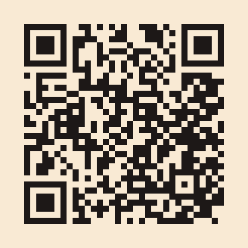
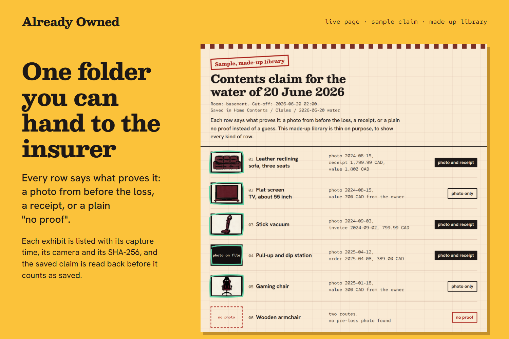

# Already Owned

 Try a practice claim, no NAS needed: https://jonathansolvesproblems.github.io/already-owned/

The PDF of this proposal is [already-owned-round1.pdf](already-owned-round1.pdf).

## 1. One sentence: What does the Skill do?

You walk the damaged room recording a voice note; the Skill finds each thing you name, and the belongings you forgot, in NAS photos taken before the loss, and writes the insurer's contents claim with that proof.

## 2. Who is the target user and problem?

Homeowners and renters. Water damaged my home twice in seven months; the insurer wanted proof of every item. My June claim: 27 items, $10,915 CAD, every photo taken after the water. Yet 22 were in photos taken for other reasons: a contractor, the first claim, daily life.

## 3. What is your proposed solution?

From a voice note or typed list, it writes the insurer's contents table: per item, a pre-loss photo and capture date, any receipt price, and a proof level or "no proof". Exhibits carry SHA-256 values. An optional weekly update keeps a dated ledger.

## 4. What is the Core User Flow?

"Flood, June 20, 2 am, basement" → I record a voice note walking the room → it finds each item in photos before 2 am, asks about things I never named → I confirm once → I approve each write.

## 5. What substantive difference does your idea offer compared with existing tools or conventional AI solutions?

A photo app finds a sofa, not a claim: you still check each date against the loss, find receipts and recall the rest. Here you walk the room talking; it applies the cut-off, pairs receipts and asks about belongings the photos show you never named.

## 6. Which UGREEN AI NAS capabilities will be used, and at which step in the workflow?

- Hear: knowledge-agent (ug-knowledge) transcribes the voice note.
- Find: photo-agent (ug-photo) searches recognized objects, keywords, text in photos and capture dates; local vision describes each hit.
- Price: document-agent (ug-document) reads receipt lines.
- Save: file-agent (ug-filesystem, ug-filemgr, file-workflow) copies, hashes, tags and reads back; knowledge-agent saves the list; photo-agent makes the album.
- Theft: security-monitor-agent (ug-surveillance) lists camera events.

## 7. What was your technical approach? Describe the planned Skill workflow, supported NAS CLI capabilities, expert agent orchestration, required inputs, permissions, AI model choices, and data handling, as applicable.

Input: loss date, time, rooms, a voice note or list. It only delegates: 25 templates, five experts. Per item: recognized object, keyword or receipt-text search, then a vision pass over photos already found; two empty routes means "no proof". Reads need no approval; every write does; saved files are read back. Experts are asked for the local model.

## 8. What is the current development status?

Implemented: full package; checker static-pass. Recall: on my 1,749 pre-loss photos, with a local 4B vision model standing in for the NAS, the Skill's search and caps proved 11 of the 22 hand-counted items, 13 when continued. Rehearsal: a small model, given only the package and a brief, drove a scripted NAS: 140 of 140 checks across 6 scenarios. Pending hardware: the NAS index, real approvals.

## 9. What is your final validation plan?

- Core 1: replay my June 2026 claim on pre-loss photos. Pass: every cited photo predates the loss; at least 15 of the 22 hand-counted items proven.
- Core 2: weekly update on a month of photos. Pass: page, album and tag exist; a rerun writes nothing.
- Edge: an item in no pre-loss photo. Pass: reported unproven, never swapped.

## 10. Are there any known limitations of your Project?

Recall depends on the NAS index; of my 27 items, 3 are unclear in photos and 2 in none. A photo proves ownership, not price. Copies need one approval per file, so large claims hash exhibits in place.

## Third-party components

None in the package: it is Markdown only. It was built and checked with the official UGOS Skill Creation Tool (`uliya-skill-kit` 0.7.3, supplied by UGREEN, used under its terms). External services and data flows: none. The Skill asks for the NAS local model and cannot override an owner's choice of an online one. Principal functionality developed for the Hackathon: all of it. Fonts in this PDF: Besley and Hanken Grotesk (SIL Open Font License); arrows and code use Windows system fonts.

AI tools: at run time, the Skill asks for the NAS local model only. During development, an AI coding assistant helped draft and revise the package and played the NAS in paper dry runs, and a smaller model played the NAS assistant in the scripted rehearsal; the recall measurement ran Qwen3.5 4B (Alibaba Qwen team, Apache 2.0) on my own computer through Ollama (MIT), standing in for the NAS; the idea, the claim data, the test design and the decisions are mine, and I reviewed every line. The drawings above were made with an image model run on my own computer (Z-Image Turbo by Tongyi-MAI, Apache 2.0, through ComfyUI, GPL-3.0) and stand in for my photos. The linked practice run uses a made-up library. Full disclosure: `references/disclosures.md` in the package.

## Entrant

Jonathan Andrei, individual entrant.

Skill package: `home-contents-inventory`. UGREEN Hackathon 2026 on AI NAS, Round 1. Track: Open Innovation.

Electronic signature: Jonathan Andrei, November 12, 2026
